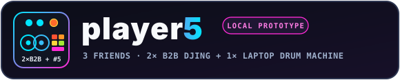
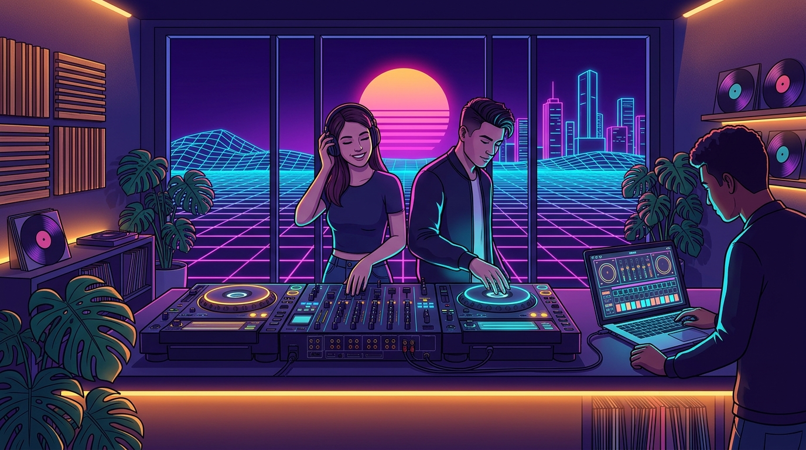
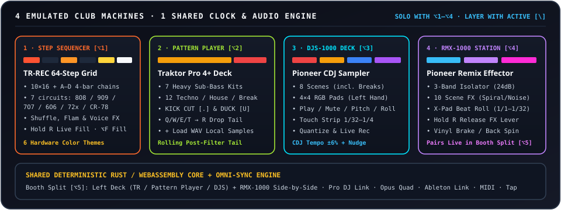
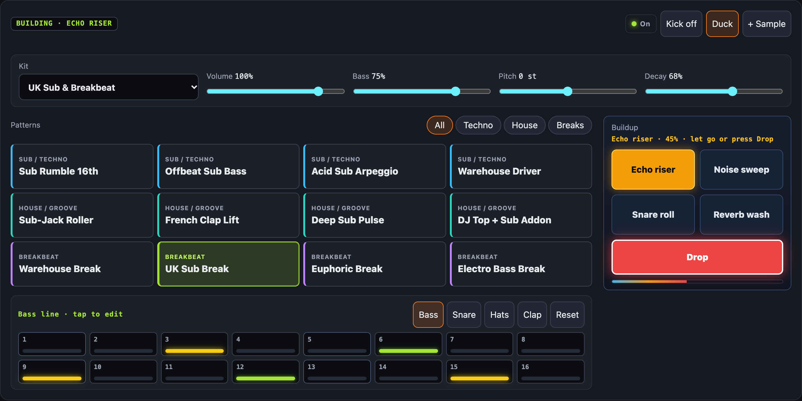
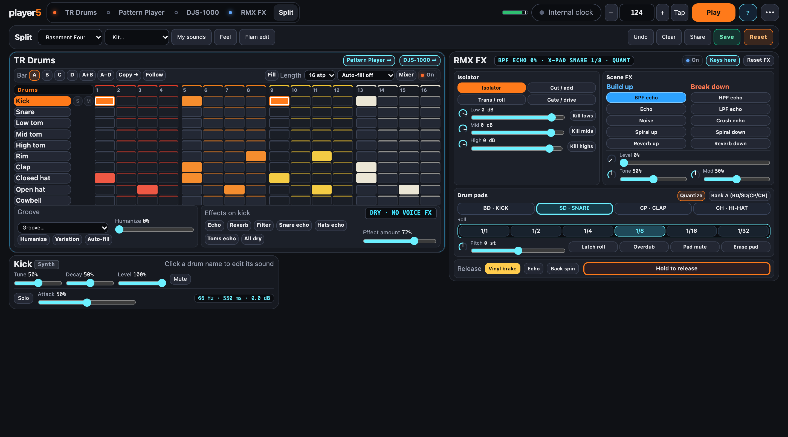
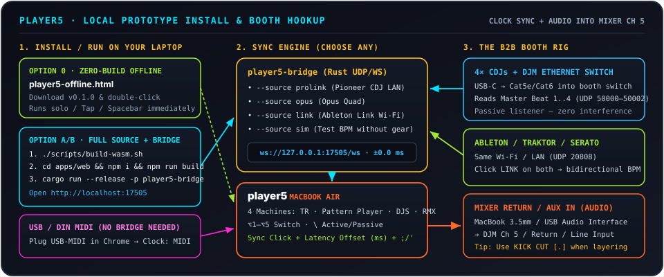

<div align="center">
  
  <br /><br />
  

  <h3>
    Berlin booth. Four CDJs. Two friends intensely pretending to tweak the EQs B2B.<br />
    <em>What is Friend #3 supposed to do — nod politely with an unlit cigarette waiting 40 minutes for a turn?</em>
  </h3>
  <p>
    Plug an Ethernet dongle into the booth switch, hijack the master clock over reverse-engineered Pro DJ Link (or Ableton Link), and declare yourself <strong>Player #5</strong> — casually dropping dub techno sub-bass, breakbeats, and dramatic noise buildups from a MacBook keyboard like it's completely normal.
  </p>
  <p>
    🎬 <a href="docs/assets/player5-overview.mp4"><strong>Watch the 18-Second Live Audio + Video Overview (<code>docs/assets/player5-overview.mp4</code>)</strong></a>
  </p>
</div>

> [!IMPORTANT]
> **Status: Shameless Local Prototype (Runs on Your Laptop Today — Native App Maybe Later)**
> Nobody asked for a Rust drum machine pretending to be a fifth CDJ, yet here we are. `player5` is currently an **early local prototype** meant for living-room afterhours, questionable studio experiments, and crashing your friends' B2B set from a browser tab (or one offline `.html` file + a tiny Rust sync bridge). Because the whole synth and sequencer core (`core/`) is already deterministic Rust, it **may grow up into a native macOS / iPadOS booth app** later.

---

## ⚡ How It Works in 10 Seconds (ADHD-Friendly Edition)

1. **Pick a machine at the top (`⌥1`–`⌥5` or `` ` ``)** — **TR Drums** (`⌥1`), **Pattern Player** *(Traktor Pro 4+ style, `⌥2`)*, **DJS-1000** (`⌥3`), **RMX FX** (`⌥4`), or **Split** (`⌥5` / `Shift + ~`).
2. **Press `Space` (or the orange `Play` button)** — instant synthesized club drums and heavy sub-bass right out of your laptop, **zero plugins or paid sample packs needed**.
3. **Click the LED dot next to any tab (or press `\` / `⌥⇧1`–`⌥⇧4`) to turn machines on or off** — off machines stay silent and ignore shortcuts. Hold **`⌘`** anytime (or enable it in **`⋯` Settings**) to reveal every keyboard shortcut overlay on screen.
4. **Cook a techno buildup & drop with one finger** — on **Pattern Player**, hold **`Echo riser`** (`Q`), **`Noise sweep`** (`W`), **`Snare roll`** (`E`), or **`Reverb wash`** (`T`), then hit **`Drop`** (`R`) on Beat 1 to slam full sub-bass back onto the groove.
5. **Glue it to your friends' decks** — click the **`Internal clock`** sync pill at the top to open **Clock & sync** for **Pioneer Pro DJ Link** / **Opus Quad**, **Ableton Link**, **USB/DIN MIDI**, or **Tap Tempo**. Press **`?`** anytime for the 30-second Quick guide.

---

## 🎛️ What It Looks Like in Action

<div align="center">
  
</div>

Every surface shares **one sample-accurate clock and Rust/Wasm audio engine**, so switching views or color themes never hiccups. Fresh builds always open clean — click **`Save`** to store your startup rig, or **`Reset`** anytime to wipe back to factory defaults.

### 1. Pattern Player *(Traktor Pro 4+ Style Heavy-Bass Layer Deck)*

Minimalist club layer deck built to ride underneath or on top of a playing DJ track. Filter by **All / Techno / House / Breaks**, tap any of the **12 patterns** (`1`–`0`, `-`, `=`), toggle **`Kick off` (`.`)** or **`Duck` (`U`)** so you never clash with the mixer's kick, and hold any of the 4 **Buildup** buttons (`Echo riser`, `Noise sweep`, `Snare roll`, `Reverb wash` → `Drop`) during breakdowns. Hold **`⌘`** to see every keyboard shortcut on the pads.



- **7 Heavy-Bass Synthesized Kits + Offline WAV Loader:** Ships with `Berlin Sub Rumble`, `Hard Industrial Sub`, `Peak-Time Acid Sub`, `UK Sub & Breakbeat`, `Minimal Sub-Click`, `Chicago Sub-Jack`, and `Top + Sub Layer (No Kick)` — plus **`+ Sample`** to drop local `.wav`/`.mp3`/`.ogg` one-shots from your laptop *(commercial artist kits inside Traktor Pro 4 are proprietary bundled assets, so `player5` synthesizes club-weight sub kits natively and supports offline local samples)*.

---

### 2. Three Classic Club Hardware Paradigms + 13" MacBook Booth Split (`⌥5` / `⇧~`)

Pair **TR Grid**, **Pattern Player**, or **DJS-1000** on the left with **Pioneer RMX-1000** on the right on a `1280×800` / `1440×800` screen with zero scrolling — and press **`⌥~`** anytime to swap keyboard focus between the left deck and `RMX-1000`.



| Machine | Switch / Toggle | Signature Workflow |
| :--- | :--- | :--- |
| **🥁 TR Step Sequencer** | View: `⌥1` · Toggle: `\` or `⌥⇧1` | `10×16` grid with **64-step `A–D` chains**, 7 drum circuits (`TR-8O8`, `TR-9O9`, `TR-7O7`, `TR-6O6`, `TR-72x`, `CR-78`), Breakbeat presets, **`Hold R` Fill**, and **`⌥F` Auto-Fill** |
| **🎛️ Pattern Player** | View: `⌥2` · Toggle: `\` or `⌥⇧2` | **12 Techno / House / Breakbeat loops** (`1–0, -, =`), heavy sub weight, **`KICK CUT` (`.`)**, **`DUCKING` (`U`)**, and **1-button Buildup → Drop (`Q/W/E/T` → `R`)** |
| **🟦 DJS-1000 Deck** | View: `⌥3` · Toggle: `\` or `⌥⇧3` | **8 Scenes** (incl. Breakbeats `S3`, `S6`, `S8`), left-hand **`4×4` RGB Pads** (`1–4 / Q–R / A–F / Z–V`), **Touch Strip** (`G/H/J/K`), and quantized **Live Rec** (`U`) |
| **🌀 RMX-1000 Station** | View: `⌥4` · Toggle: `\` or `⌥⇧4` | **3-Band Isolator Kills** (`Q/W/E`), **10 Scene FX** (`Y–P` Build / `A–G` Break), **X-Pad Roll Ribbon** (`1–4` + `5–0`), and **`Hold R` Release Lever** |


---

### 3. 30-Second Quick Guide & Full Animated Visual Manual (`?`)

Press **`?`** anytime for a **3-step 30-second Quick guide** tailored to whichever machine you're on, with an expandable **Keyboard map** and the full **3Blue1Brown-style animated manual** tucked neatly underneath so beginners aren't hit with a wall of text.


---

## 🛠️ How to Install & Start (Local Prototype)

<div align="center">
  
</div>

### Option 0: Zero-Build Offline File (Fastest)

Download **`player5-offline.html`** from the [**`v0.1.0` Release**](https://github.com/dnovakovskiy/player5/releases/tag/v0.1.0) and double-click it in Chrome, Safari, or Edge. Everything (synthesizer, 4 surfaces, visual manual) runs locally with zero server and zero network requests *(note: Pro DJ Link / Ableton Link sync needs the local bridge below)*.

### Option A: Copy-Paste Prompt for Your AI Coding Agent

Using **Antigravity**, **Claude Code**, **Cursor**, or **Codex**? Paste this prompt:

```text
Clone https://github.com/dnovakovskiy/player5.git (if not already cloned), check that Rust (with wasm32-unknown-unknown) and Node.js 20+ are installed, build the WebAssembly DSP core with ./scripts/build-wasm.sh, install web dependencies in apps/web, start the local dev server, and give me the localhost URL to open in Chrome.
```

### Option B: Run Locally from Source (Mac / Linux)

**Prerequisites:** [Node.js 20+](https://nodejs.org/) and [Rust (`rustup`)](https://rustup.rs/).

```sh
git clone https://github.com/dnovakovskiy/player5.git
cd player5
rustup target add wasm32-unknown-unknown
./scripts/build-wasm.sh
cd apps/web && npm install && npm run dev
```

Open **`http://localhost:5173`**, hit **`Space`**, and start annoying your B2B friends. *(Or run `npm run build:single` inside `apps/web` to pack everything into one offline file at `apps/web/dist-single/player5.html`.)*

---

## 🥁 Plugging In Your Own Sounds (Native Instruments Maschine / Custom `.wav` Kits)

Out of the box, `player5` synthesizes every drum in pure Rust math (`[SYNTH]`) so the repo stays lightweight and 100% free of copyrighted audio. Want real studio punch from libraries you **already own on your laptop** (like **NI Maschine 2 Factory**, **Deep Matter**, **Expansions**, or any personal `.wav` pack)?

1. **Zero-Setup Browser Picker (Works Everywhere):**
   - Click **`My sounds`** in the top toolbar → **`+ Load NI / WAV Folder`** → point it at e.g. `/Users/Shared/Deep Matter Library/Samples/Drums` or `/Users/Shared/Maschine 2 Factory Library Library/Samples/Drums`.
   - `player5` auto-maps **Kick, Snare, Clap, Closed/Open Hat, Rim, Toms & Cowbell** straight into the AudioWorklet sampler (`Auto-Fill Kit`), and every plugged-in voice gets an emerald **`[WAV]`** badge + sample name so you never confuse NI samples with built-in `[SYNTH]`.
2. **Automatic Local Mount via `player5-bridge`:**
   - Start `player5-bridge` (or pass `--samples-dir "/path/to/your/drums"`). On macOS it automatically discovers NI sample libraries in `/Users/Shared` and serves them locally at `http://localhost:17505` with zero copying into the repo.
3. **Bookmark Your Go-To Hits (`★ Favorites`):**
   - Click **`☆ → ★`** next to any sample in the browser to pin your favorite NI kicks, claps, and tops to the top of the list, and toggle **`★ Favorites Only`** mid-set.

---

## 🔗 Syncing with Friends' CDJs, Opus Quad, Ableton Link & MIDI

| Booth Setup | What You Need | Exact Setup Steps |
| :--- | :--- | :--- |
| **Pioneer CDJ-2000NXS2 / CDJ-3000 + DJM** *(Pro DJ Link)* | USB-C → Ethernet into the booth LAN switch | Build web (`cd apps/web && npm run build`), then from repo root run `cargo run --release -p player5-bridge -- --source prolink --web apps/web/dist` (use `--source opus` for **AlphaTheta Opus Quad**). Open **`http://localhost:17505`**, select **`Bridge`** in **CLOCK**, click **`Connect`**, and set **Follow** to **`Tempo master`**. |
| **Ableton Live, Traktor Pro 4, Serato, Rekordbox, DJay** *(Ableton Link)* | Same Wi-Fi / LAN | Enable **Link** in your DJ app/DAW, build web (`cd apps/web && npm run build`), then run `cargo run --release -p player5-bridge --features ableton-link -- --source link --web apps/web/dist`. Open **`http://localhost:17505`**, select **`Ableton Link`** in **CLOCK**, and click **`Join Link`**. |
| **Hardware Mixer / Synth MIDI Out** *(24 PPQN)* | USB-MIDI cable + Chrome/Edge | Select **`MIDI`** in **CLOCK** and pick your MIDI input port. |
| **Vinyl / Turntables / Zero Cables** *(Tap + Nudge)* | Just your ears | Select **`Tap`** in **CLOCK**, tap **`T`** 4× on the kick, and nudge phase `±1 ms` with **`;` / `'`** + calibrate speaker delay with **`Sync Click`**. |

---

## 🧭 Where `player5`'s Specific Novelty Sits (Even Though Nobody Asked for It)

Look, running a reverse-engineered CDJ protocol in Rust so a 3rd friend can mash drum rolls on a MacBook keyboard behind two serious techno DJs is inherently absurd — which is exactly why it's fun. Surprisingly, though, **nothing else on GitHub actually puts all the pieces together**:

- **Sync-Only Bridges** (`Deep-Symmetry/beat-link-trigger`, `strikeout/autoblink`, `Suva/pro-dj-link-to-midi`, `evanpurkhiser/prolink-go`, `kyleawayan/opus-quad-pro-dj-link-analysis`): Brilliant at decoding Pro DJ Link / Opus Quad packets, **zero sound engine**. You still need Ableton Live or an \$800+ hardware drum machine on the receiving end.
- **Browser Drum Toys** (`io-8O8` web clones, `gdamdam/mpump`, `x-1000`, `noturderek/djs1000-emulator`): Fun in isolation, **useless in an actual DJ booth** — they lack native Pioneer Pro DJ Link + Opus Quad + 24-PPQN MIDI PLL phase-locking, or require proprietary QEMU firmware images.
- **`player5` = All Booth Sync Protocols Built Directly Into a Multi-Device Instrument:**
  1. **Omni-Protocol Clock Follower Inside the Audio Engine (`core/clock` + `apps/bridge`):** Native clean-room Rust followers for **Pioneer Pro DJ Link**, **AlphaTheta Opus Quad**, **Ableton Link (`UDP 20808`)**, **USB/DIN MIDI (24 PPQN PLL)**, and **Tap + ms phase/latency calibration** feeding sample-accurate lookahead scheduling directly — no virtual MIDI buses, no JVM, no extra DAW.
  2. **4 Club Workflows + Owned NI `.wav` Samples + Built-In Synth (`core/dsp` + `host.js`):** **TR Step Sequencer**, **Traktor-style Pattern Player** (with tempo-synced noise buildups & rolling post-filter drop tails), **DJS-1000 Pad/Scene Deck**, and **RMX-1000 Remix Station** — all playable from one laptop keyboard with **`ACTIVE`/`PASSIVE`** zero-bleed routing.

---

<details>
<summary><strong>🧪 Developer Commands &amp; Architecture Docs (Click to expand)</strong></summary>

<br />

```sh
cargo fmt --check
cargo clippy --workspace --all-targets -- -D warnings
cargo test --workspace
cd apps/web && npm run check && npm run verify-wasm && npx playwright test
```

- [`CLAUDE.md`](CLAUDE.md) — architecture conventions & test invariants
- [`apps/bridge/README.md`](apps/bridge/README.md) — `player5-bridge` CLI flags (`prolink`, `opus`, `sim`, Ableton Link)
- [`docs/adr/`](docs/adr/) & [`docs/protocols/`](docs/protocols/) — clean-room protocol & DSP architecture notes

</details>
