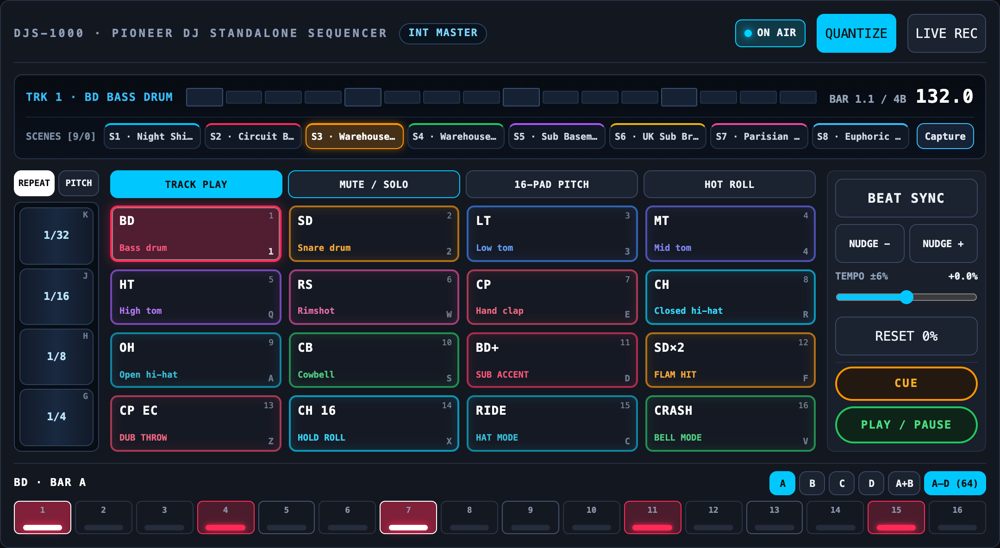
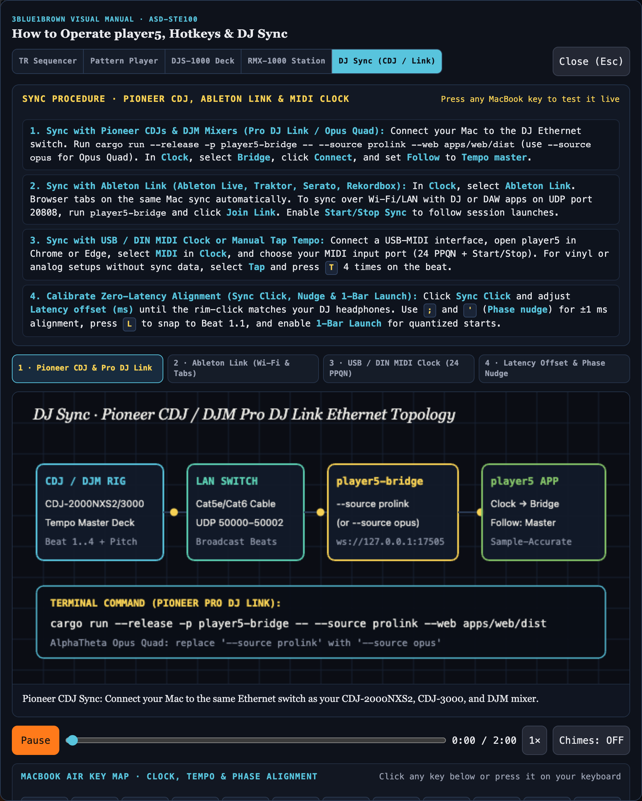

<div align="center">
  
  <br /><br />
  

  <h3>
    Four friends at a 4-deck Pioneer setup. Two are B2B DJing.<br />
    <em>What does Friend #3 do besides stand behind the booth waiting 20 minutes for a turn?</em>
  </h3>
  <p>
    Open your laptop, lock to the master clock, and become <strong>Player #5</strong> — layering heavy sub-bass grooves, breakbeats, live pad rolls, and one-button buildup drops right on top of the mix.
  </p>
</div>

> [!IMPORTANT]
> **Status: Local Prototype (Runs on Your Laptop Today — Native App Later)**
> `player5` is currently an **early local prototype** meant for bedroom jams, house parties, and studio tests on your own machine (in a browser tab, as a single offline `.html` file, or paired with a tiny local Rust sync bridge). Everything runs on a deterministic **Rust DSP + Sequencer core** (`core/`), so once the booth workflow is battle-tested it **may become a standalone native macOS / iPadOS app** down the road.

---

## ⚡ How It Works in 10 Seconds (ADHD-Friendly Edition)

1. **Pick one of 4 club-inspired machines** at the top of the window — **TR Step Sequencer**, **Pattern Player** *(Traktor Pro 4+ style)*, **DJS-1000 Pad Deck**, or **RMX-1000 Remix Station** (or hit **`Booth Split`** to put two side-by-side on a 13" MacBook Air with zero scrolling).
2. **Press `Space`** — instant synthesized drums and heavy sub-bass right out of your laptop, **zero plugins or paid sample packs needed**.
3. **Solo or layer with `ON AIR`** — switching tabs solos that machine automatically so all four don't talk over each other, or click multiple **`ON AIR`** pills (`TR Drums` + `Pattern Player` + `DJS-1000`) to stack grooves live through the **`RMX-1000`** effector.
4. **Cook a buildup & drop with one finger** — hold **`Q`**, **`W`**, **`E`**, or **`T`** in Pattern Player (echo + high-pass filter, white-noise sweep, snare spiral, or sub-kill wash), then **release (or tap `R`) on Beat 1** to slam straight back into the heavy bass groove.
5. **Glue it to your friends' decks** — plug into the booth Ethernet switch (**Pioneer Pro DJ Link**), hop on Wi-Fi (**Ableton Link**), or use **MIDI / Tap Tempo** so your patterns stay beat-locked to whatever track is playing on Decks 1–4.

---

## 🎛️ What It Looks Like in Action (4 Machines in 1 Window)

Every view shares **one sample-accurate clock and audio engine**, so flipping between decks or themes never drops a beat. Fresh builds always boot clean — click **`Save`** to keep your favorite startup rig, or **`Reset`** anytime to wipe back to factory defaults.

### 1. Pattern Player *(Traktor Pro 4+ Style Heavy-Bass Layer Deck)*

Built specifically for **layering underneath or on top of a live DJ track** without clutter. Pick a heavy sub-bass or percussive club kit, punch in one of **12 pre-baked Techno Sub, House, or Breakbeat loops** (`1`–`0`, `-`, `=`), flip **`KICK CUT`** (`.`) or **`DUCKING`** (`U`) so you never clash with the DJ's kick drum, and ride the **`BUILDUP → DROP FX`** bar during breakdowns.


- **7 Heavy-Bass Synthesized Kits Built In:** `Berlin Sub Rumble`, `Hard Industrial Sub`, `Peak-Time Acid Sub`, `UK Sub & Breakbeat`, `Minimal Sub-Click`, `Chicago Sub-Jack`, and `Top + Sub Layer (No Kick)` — plus an offline **`+ Load WAV`** button to drop in any `.wav`/`.mp3`/`.ogg` one-shot from your own laptop *(commercial artist packs inside Traktor Pro 4 are proprietary to Native Instruments, so `player5` synthesizes club-weight sub kits natively and lets you load local files offline)*.
- **One-Button Buildup → Release Into Drop:** Tap **`Q`** (`ECHO + HPF FILTER`), **`W`** (`NOISE + FILTER SWEEP`), **`E`** (`SPIRAL + SNARE ROLL`), or **`T`** (`SUB KILL + REVERB`) once to latch a rising buildup hands-free — or **hold the key down** through the breakdown and **let go on Beat 1** (or hit **`R`**) to snap every filter/echo clean and slam the sub back in.

---

### 2. MacBook Air 13" Booth Split (`TR-REC` / `Pattern Player` / `DJS-1000` + `RMX-1000`)

Hit **`Shift` + `` ` ``** (or click **`Booth Split`**) for a zero-scroll dual cockpit fitted to a `1280×800` / `1440×800` laptop screen on a crowded DJ table: swap **TR Grid**, **Pattern Player**, or **DJS-1000** on the left while keeping the **Pioneer RMX-1000 Remix Station** permanently under your right hand.


| Surface | What You Get | Killer Party Trick |
| :--- | :--- | :--- |
| **🥁 Step Sequencer** | Classic `10×16` drum grid with **4-bar / 64-step chains** (`A`, `B`, `C`, `D`, `A–D`), 7 classic drum kits (`TR-8O8`, `TR-9O9`, `TR-7O7`, `TR-6O6`, `TR-72x`, `CR-78`), Shuffle, Flam & Per-Sample FX | Clone Bar `A → B → C → D`, select Bar `D`, and press **`Option + F`** (`Auto-Fill`) for an instant 4th-bar turnaround roll |
| **🌀 RMX-1000 Station** | **3-Band Isolator** (`Cut/Add`, `Kill`, `Trans/Roll`, `Gate/Drive`), **10 Scene FX** (`BPF Echo`, `Noise`, `Spiral Up/Down`, `Crush Echo`, `Reverb`), **X-Pad Roll Ribbon**, and **Release Lever** | Crank `SPIRAL UP` (`O`), hold an X-Pad `1/16` snare roll (`9`), then **hold `R`** (`Vinyl Brake`) and release on Beat 1 |

---

### 3. Pioneer DJS-1000 Standalone Pad Deck (+ Pre-Baked Breakbeats)

Switch to **`DJS-1000 Deck`** (shown below in the **`Pioneer CDJ`** hardware theme) for an 8-Scene launcher (**House, Techno, plus `Warehouse Break`, `UK Sub Break`, and `Euphoric Break`**), a **`4×4` velocity RGB pad matrix** mapped directly under your left hand (`1–4`, `Q–R`, `A–F`, `Z–V`), a **`1/32–1/4` Touch Strip** (`G/H/J/K`), and quantized **`LIVE REC`** (`C` / `V`) overdubbing.



---

### 4. Interactive 3Blue1Brown Visual Manual & DJ Sync Guide (`?`)

Press **`?`** (or click **`How to · ?`** / **`Sync Guide · ?`**) anytime inside the app. Every device has **un-rushed 3Blue1Brown-style animated visual chapters**, crisp step-by-step operating cards, and a **live MacBook Air keyboard tester** that lights up as you press keys.



---

## 🛠️ How to Install & Start (Local Prototype)

### Option A: Let Your AI Coding Agent Set It Up for You

If you use **Antigravity**, **Claude Code**, **Cursor**, or **Codex**, paste this prompt and let it build and launch `player5` for you:

```text
Clone https://github.com/dnovakovskiy/player5.git (if not already cloned), check that Rust (with wasm32-unknown-unknown) and Node.js 20+ are installed, build the WebAssembly DSP core with ./scripts/build-wasm.sh, install web dependencies in apps/web, start the local dev server, and tell me the localhost URL to open in Chrome.
```

### Option B: 3 Terminal Commands ("Just Let Me Jam")

**Prerequisites:** [Node.js 20+](https://nodejs.org/) and [Rust (`rustup`)](https://rustup.rs/) with the Wasm target (`rustup target add wasm32-unknown-unknown`).

```sh
git clone https://github.com/dnovakovskiy/player5.git
cd player5
./scripts/build-wasm.sh
cd apps/web && npm install && npm run dev
```

Open **`http://localhost:5173`** in Chrome/Edge/Safari, hit **`Space`**, and start jamming!

> [!TIP]
> **Want a zero-server offline file you can drop on your Desktop?**
> Run `cd apps/web && npm run build:single` to pack the entire synth, Wasm engine, and all 4 decks into a single self-contained file at **`apps/web/dist-single/player5.html`** — double-click it anywhere, even on airplane Wi-Fi.

---

## 🔗 How to Sync with Friends' CDJs, Ableton Link & DJ Software

When two friends are mixing B2B and you bring your laptop as **Deck #5**, pick whichever sync path matches the booth setup:

| Booth Setup | What You Need | Exact Setup Steps |
| :--- | :--- | :--- |
| **Pioneer CDJ-2000NXS2 / CDJ-3000 + DJM** *(Pro DJ Link)* | USB-C → Ethernet adapter into the booth LAN switch | Run `cargo run --release -p player5-bridge -- --source prolink --web apps/web/dist` (use `--source opus` for **AlphaTheta Opus Quad**), open **`http://localhost:17505`**, select **`Bridge`** in the **CLOCK** panel, click **`Connect`**, and set **Follow** to **`Tempo master`**. |
| **Traktor Pro 4, Serato, Rekordbox, DJay, or Ableton Live** *(Ableton Link over Wi-Fi)* | Same Wi-Fi / LAN network | Turn on **Link** in your DJ app. Run `cargo run --release -p player5-bridge -- --web apps/web/dist`, select **`Ableton Link`** in **CLOCK**, and click **`Join Link`**. *(Two `player5` tabs on the same Mac also sync automatically!)* |
| **Hardware Mixer / Drum Machine MIDI Out** *(24 PPQN)* | USB-MIDI cable + Chrome or Edge | Plug in your MIDI interface, select **`MIDI`** in **CLOCK**, and pick your MIDI input port. |
| **Turntables / Vinyl / Zero Cables** *(Manual Ear Sync)* | Just your ears + laptop | Select **`Tap`** in **CLOCK**, tap **`T`** four times on the kick drum, and nudge phase by `±1 ms` with **`;`** / **`'`** (or `NUDGE − / +` on DJS-1000) just like riding a pitch fader. |

**Dialing out speaker / audio-interface delay in 5 seconds:**
1. Put one ear in your headphones or listen to the booth monitor and click **`Sync Click`** in the **CLOCK** bar.
2. Adjust **`Latency offset (ms)`** until `player5`'s rim-click lands dead-on with the DJ mixer's kick, then turn **`Sync Click`** off.
3. Enable **`1-Bar Launch`** (or press **`L`**) so every pattern start snaps cleanly to **Beat `1.1`** of the bar.

---

## ⌨️ MacBook Keyboard Cheat-Sheet (Mode-Reactive)

Every control prints its shortcut right in the corner of the pad or button, and pressing **`?`** opens the interactive key map.

- **Global Everywhere:** **`Space`** Play/Stop · **`` ` ``** Cycle Decks · **`Shift + ` `** Booth Split · **`[ / ]`** ±1 BPM · **`; / '`** Phase Nudge · **`L`** Re-sync Beat 1.1 · **`?`** Visual How-To
- **Pattern Player (`Traktor Pro 4+`):** **`1–0, -, =`** 12 Techno / House / Breakbeat Patterns · **`Q / W / E / T`** Buildup FX (Tap to latch or Hold) · **`R`** **Release Into Drop!** · **`.`** Kick Cut · **`U`** Ducking · **`A–K / Z–,`** 16 Steps
- **DJS-1000 Deck:** **`1–4 / Q–R / A–F / Z–V`** `4×4` RGB Pads · **`5 / 6 / 7 / 8`** Pad Modes (`Track / Mute / Pitch / Roll`) · **`G / H / J / K`** Touch Strip Rolls · **`9 / 0`** Prev/Next Scene
- **RMX-1000 Station:** **`Q / W / E`** Kill Low/Mid/High · **`Y–P`** Build-Up FX · **`A–G`** Break-Down FX · **`1–4`** X-Pad Sample + **`5–0`** Roll Ribbon · **`Hold R`** Release Lever Drop
- **TR Step Sequencer:** **`1–0`** Select Drum (`Shift + 1–0` Audition · `Ctrl + 1–0` Dub Echo) · **`A–K / Z–,`** Toggle Steps 1–16 · **`Option + G / V / F`** Humanize / Variation / Auto-Fill

---

## 🎨 6 Hardware Color Schemes

Switch themes anytime from the top bar (saved automatically):
- 🟠 **`8O8 Booth`** — Dark club charcoal + warm orange & ice-cyan playhead *(default)*
- 🔴 **`8O8 Classic`** — Classic 4-color vermilion / orange / yellow / cream step groups
- ⚪ **`9O9 Silver`** — Daytime-friendly brushed aluminum chassis & crimson LEDs
- 🟢 **`TR-8S Neon`** — Obsidian black + glowing per-row RGB fader colors
- 🔵 **`Pioneer CDJ`** — Anodized club gunmetal + Rekordbox cyan OLED & cue/sync accents
- 🟣 **`NI Maschine`** — Matte studio slate + jewel-tone RGB pad groups

---

<details>
<summary><strong>🧪 Developer Commands, Native App Roadmap &amp; Architecture Docs (Click to expand)</strong></summary>

<br />

Under the hood, a single deterministic `no_std`-friendly **Rust workspace** (`core/dsp`, `core/seq`, `core/clock`, `core/render`) drives WebAssembly in the browser today and links into experimental CoreAudio shells (`apps/mac`, `apps/ios`) as `player5` evolves toward a native app:

```sh
# Rust formatting, clippy, golden WAV fingerprints & trademark checks
cargo fmt --check
cargo clippy --workspace --all-targets -- -D warnings
cargo test --workspace

# Web typecheck, Wasm parity check & full Playwright E2E suite
cd apps/web
npm run check
npm run verify-wasm
npx playwright test
```

- [`CLAUDE.md`](CLAUDE.md) — workspace layout, build pipeline & test invariants
- [`apps/bridge/README.md`](apps/bridge/README.md) — all `player5-bridge` CLI flags (`prolink`, `opus`, `sim`, Ableton Link)
- [`docs/adr/`](docs/adr/) & [`docs/protocols/`](docs/protocols/) — architecture decisions & clean-room sync protocol notes

</details>
