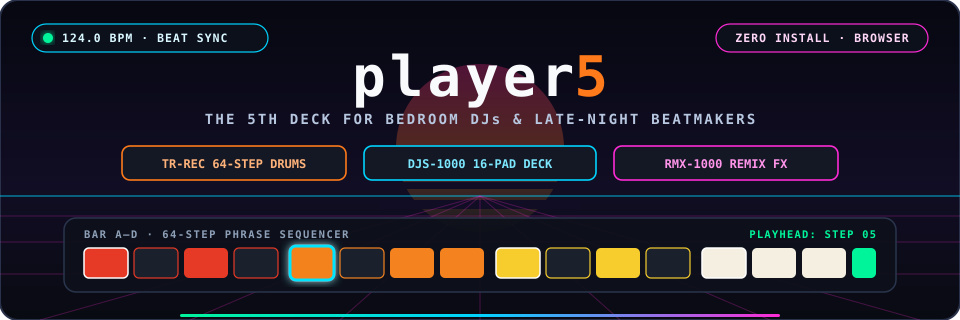
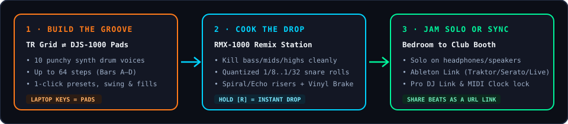

<div align="center">
  

  <p>
    <strong>Club DJ setups have Decks 1–4. This is Deck #5.</strong><br />
    A classic drum machine, a 16-pad DJ sampler, and a hands-on remix FX box — jammed into one browser tab, zero plugins required.
  </p>
</div>

---

## ⚡ TL;DR (For Impatient Brains)

- **What is it?** Three pieces of iconic DJ/studio hardware fused into **one app** so you can sketch loops on your couch or drop live drums & FX over a bedroom DJ set.
- **Do I need MIDI controllers or CDJs?** **Nope.** Your laptop keyboard plays every pad, step, roll, and FX drop. (If you *do* use Ableton, Traktor, Serato, or Pioneer decks, it locks right to your BPM.)
- **How fast do I get sound?** Open it → hit **`Space`** → pick a preset (`House`, `Techno`, `Nu-Disco`) → start clicking glowing steps.
- **How do I save a beat?** Every tweak updates the URL. Copy the link, text it to a friend, or bookmark it.

<div align="center">
   2. Cook the Drop -> 3. Jam Solo or Sync" width="100%" />
</div>

---

## 🚀 Start Making Noise in 30 Seconds

Pick whichever matches your energy level right now:

### 1. "Just let me play" (Local Web App)
```sh
scripts/build-wasm.sh
cd apps/web && npm install && npm run dev
```
Open **`http://localhost:5173`** and press **`Space`**. Done! *(Tip: `npm run build:single` packs the entire synth + UI into one offline file at `apps/web/dist-single/player5.html` you can double-click anywhere.)*

### 2. "Sync it to my DJ software / decks"
Run the tiny companion bridge so your browser can hear **Ableton Link** (Ableton Live, Traktor, Serato, DJay) or **Pioneer Pro DJ Link**:
```sh
scripts/build-wasm.sh && (cd apps/web && npm install && npm run build)
cargo run --release -p player5-bridge -- --source prolink --web apps/web/dist
```
Open **`http://localhost:17505`** → click **Ableton Link** or **Bridge** in the Clock bar → your drums are now glued to your mix.

---

## 🎛️ 3 Gear Boxes in 1 Tab

Switch views anytime at the top — they all share **one clock and one audio engine**, so the beat never hiccups:

| Mode | Vibe | Best For |
| :--- | :--- | :--- |
| **🥁 Step Sequencer** | Classic `10×16` drum machine with **4-bar / 64-step** chains (`A`, `B`, `C`, `D`, `A–D`) | Programming house/techno grooves, swing, flams, and 4th-bar turnaround fills |
| **🟦 DJS-1000 Deck** | CDJ-style 7" screen + **8 Scenes** + **4×4 RGB Pads** + Touch Strip | Finger-drumming, muting stems live, chromatic bass/tom melodies, and launching scenes |
| **🌀 RMX-1000 Station** | Club remix effector: **3-Band Isolator**, **X-Pad Roll**, **10 Scene FX**, **Release Lever** | Killing the kick, building huge risers, 1/16→1/32 snare rolls, and clean vinyl-brake drops |
| **💻 Booth Split** *(MacBook Air 13")* | Zero-scroll side-by-side cockpit (`Shift` + `` ` ``) | **Drum Machine or DJS-1000 on the left** + **RMX-1000 FX on the right** on one screen |

---

## 🧪 3 Instant "Sound Like a Pro" Recipes

Don't know where to start? Try any of these 10-second combos while the beat is playing (`Space`):

1. **🔥 The Classic Club Riser & Clean Drop**
   - Switch to **Booth Split** (`Shift` + `` ` ``).
   - Under **SCENE FX**, click **`SPIRAL UP`** or **`BPF ECHO`** and drag **Scene Level** up to `75%`.
   - Right on beat 4, **hold `R`** (or pull the **Release Lever**) for a Vinyl Brake, then **let go on Beat 1** — instant clean drop back into the groove.

2. **🥁 The 64-Step "Every 4th Bar" Turnaround**
   - In **Step Sequencer**, click **`Copy→`** three times to clone your 1-bar loop across Bars **`A → B → C → D`**.
   - With **`D`** selected, click **`Auto-Fill [⌥F]`** to drop a snare/tom roll at the end of Bar 4.
   - Click **`A–D`** — your loop now breathes like a full 4-bar track instead of a repetitive 1-bar loop.

3. **🎹 Finger-Drum & Overdub on the DJS-1000**
   - Click **`DJS-1000 Deck`** → hit **`QUANTIZE`** (on by default) + **`LIVE REC`**.
   - Tap the glowing RGB pads or hold the left **Touch Strip (`1/16`)** — every hit snaps to the beat grid and writes itself into the pattern!

---

## ⌨️ Your Laptop Keyboard = Drum Pads

Hit **`?`** inside the app anytime for an interactive visual cheat-sheet. Here are the heavy hitters:

```text
┌──────────────────────────────────────────────────────────────────────────┐
│  [ ~ ] Cycle Decks   [ 1 ][ 2 ][ 3 ][ 4 ]...[ 0 ] Select / Trigger Drum  │
│  [Shift + ~] Split   [ Q / W ] Prev/Next Preset   [ Hold R ] Vinyl Drop  │
│                      [ A ][ S ][ D ][ F ][ G ][ H ][ J ][ K ] Steps 1–8  │
│                      [ Z ][ X ][ C ][ V ][ B ][ N ][ M ][ , ] Steps 9–16 │
│                      [         SPACE = PLAY / STOP          ]            │
└──────────────────────────────────────────────────────────────────────────┘
```

- **`Shift` + `1–0`** → Bang drum voices live like velocity pads
- **`Ctrl` + `1–0`** → Throw tempo-synced Dub Echo on individual drums
- **`Option` + `G` / `V` / `F`** → Humanize pocket / Mutate groove / Inject drum fill
- **`Y` `U` `I` `O` `P`** → Swap analog drum kits on the fly without losing your pattern

---

## 🎨 6 Hardware Color Schemes

Match your room lighting (or late-night eyeballs) from the top-right theme picker — saved automatically:

- 🟠 **`8O8 Booth`** — Matte dark charcoal + high-contrast orange & cyan playhead *(default)*
- 🔴 **`8O8 Classic`** — Warm carbon + iconic vermilion / orange / yellow / cream 4-step key groups
- ⚪ **`9O9 Silver`** — Daytime-friendly brushed aluminum chassis, dark keys & crimson LEDs
- 🟢 **`TR-8S Neon`** — Obsidian club black + glowing neon RGB fader colors per drum row
- 🔵 **`Pioneer CDJ`** — Anodized club gunmetal + Rekordbox ice-cyan OLED & crimson Cue/Sync
- 🟣 **`NI Maschine`** — Studio slate + jewel-tone RGB pad groups & crisp flat pad geometry

---

<details>
<summary><strong>🔌 Connecting Real DJ Gear, Ableton Link, Opus Quad, or Simulator (Click to expand)</strong></summary>

<br />

- **Ableton Link (Wi-Fi / LAN):** Select **Ableton Link** in the Clock panel. Two browser tabs on the same laptop sync automatically; run `player5-bridge` to sync across Wi-Fi/LAN with Ableton Live, Traktor, Serato, or Rekordbox.
- **Pioneer Pro DJ Link (CDJs + DJM):** Wire your laptop to the Ethernet switch on the booth rig and run:
  ```sh
  cargo run --release -p player5-bridge -- --source prolink --web apps/web/dist
  ```
- **AlphaTheta Opus Quad:** Use `--source opus`.
- **No hardware handy? Simulate a DJ deck:** Use `--source sim --sim-bpm 124`. See `apps/bridge/README.md` for all flags.
- **Dialing in Bluetooth / speaker delay:** Click **`Sync Click`** in the Clock bar and nudge **Latency offset (ms)** until the rim-click lands dead-on with your headphones.

</details>

<details>
<summary><strong>🛠️ Developer Commands, Native macOS/iOS Apps &amp; Architecture Docs (Click to expand)</strong></summary>

<br />

One deterministic **Rust DSP + Sequencer core** powers everything: WebAssembly + `AudioWorklet` in the browser (with a pure-JS fallback for strict sandboxes), native CoreAudio on macOS/iOS, and the network sync bridge.

```sh
# First-time Wasm target setup
rustup target add wasm32-unknown-unknown
scripts/build-wasm.sh

# Web app dev & builds
cd apps/web && npm install && npm run dev        # http://localhost:5173
cd apps/web && npm run build:single              # self-contained dist-single/player5.html

# Rust tests, golden WAV fingerprints & offline renderer
cargo test --workspace
cargo run -p render -- patterns/kit-warehouse.json out.wav --fingerprint
```

- **macOS & iOS native apps:** Run `scripts/build-xcframework.sh`, then open `apps/mac` (Swift package) or `apps/ios` (XcodeGen).
- **Deep-dive docs:**
  - `CLAUDE.md` — architecture conventions, build pipeline & test invariants
  - `docs/adr/` — architecture decision records
  - `docs/protocols/` — clean-room protocol notes (Pro DJ Link, Opus Quad, Ableton Link, MIDI clock, Bridge WebSocket)

</details>
